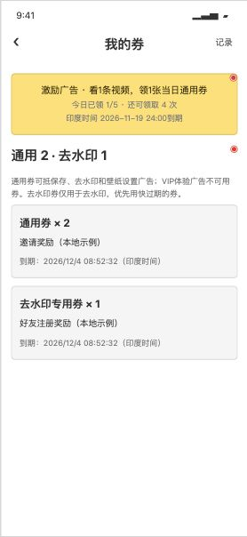
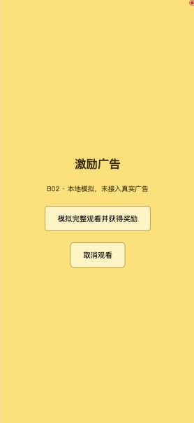
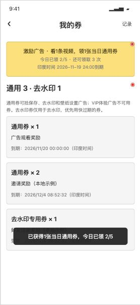
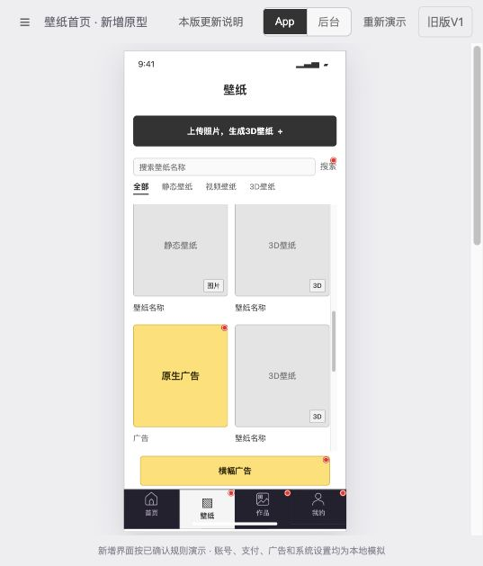
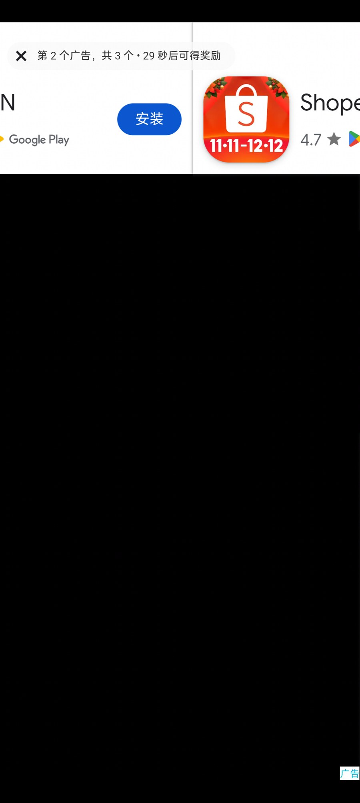
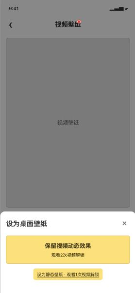
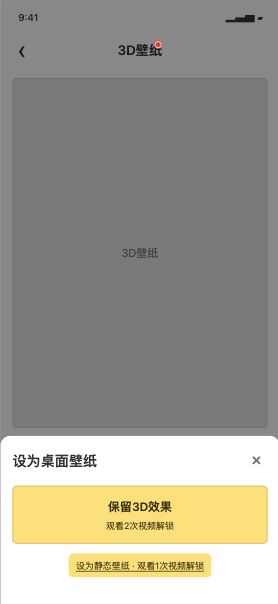

# FireVidu广告位置与新增建议

2026-11-20　V2.6.1 完整规则及后台场景细分版

本版整理原有广告基线、四类新增方案及其触发、计数、频控和异常规则。当前后台按实际路径细分41条本地演示场景，回前台开屏按满3分钟返回触发；细分行数不等于本轮新增广告数。壁纸记录与保存成功页继续保留原横幅。当前广告、奖励及设置均为本地模拟，正式SDK和服务端尚待接入。

黑字为已有广告；蓝字为竞品参考建议；橙字为独立建议。新增位置已接入本地原型，正式SDK未接入。黄底区域及其副文案统一使用高对比深色，不调整字号和静态选项的低强调布局。

本轮保留4类新增：B01模板浏览返回插页、B02自愿看激励领券、O01壁纸列表单格原生、O04壁纸首页及搜索结果底部横幅。按用户最终决定，两类壁纸广告同时存在，独立配置。四项仅接入本地原型。

壁纸记录和保存成功页继续保留旧横幅。本轮不新增O02/O03原生，不标取消红框，也不再绘制替换箭头。

相对V1新增广告统一用黄色块注明类型；激励与插页不混写。红点按功能合并：首页模板列表1点，壁纸静态/视频/3D各1点，保存选项仅高清1点，选券弹层1点。壁纸搜索独立成页，不显示类型标签。

## 已有广告位置
以下黑字记录V2.5.1核对基线中的14个原合并配置行，不是当前后台的场景总数。最新后台已将合并项按实际路径拆成41条场景，并补充VIP体验和壁纸解锁的专属开关；本报告后附完整细分名称。全部广告仍为本地原型模拟。

|编号|已有位置|类型|出现时机|已确认说明|
|---|---|---|---|---|
|E01|启动页开屏广告|开屏|启动原型→开屏示意→首页/语言选择|普通/会员默认开；本地示意，无真实SDK。|
|E02|回前台开屏广告|开屏|后台满3分钟返回，按配置展示开屏后回原页|普通/会员独立配置；既有位置补本地演示，不算新增方案。|
|E03|首页下方横幅广告|横幅|首页底部常驻；关闭后留在首页|普通开/会员关。|
|E04|模板详情下方横幅广告|横幅|制作同款/照片准备页底部；留在本页|普通开/会员关；反馈免费重做仍保留该页横幅。|
|E05|模板原生广告|原生|首页模板流、作品“我的创作”中的广告卡|普通/会员默认开；壁纸首页、壁纸记录未有此原生。|
|E06|正在制作原生广告卡片|原生|正在制作进度页的原生卡；不阻断制作|普通/会员默认开；卡片曝光不等于完成激励。|
|E07|正在制作激励广告|激励|制作中主动解锁高清→1条激励→继续制作|普通/会员默认开；与最终高清保存共享资格，不重复收取。|
|E08|制作完成下方横幅广告|横幅|制作完成及视频保存成功等结果页底部|普通开/会员关；一个配置覆盖多个结果页。|
|E09|制作同款开始制作插页广告|插页|图片开始制作；另复用于照片3D生成、动态历史再设|普通开/会员关；同一开关复用，不算3个配置。视频开始制作当前绕过此分支。|
|E10|作品下方横幅广告|横幅|作品列表/详情、壁纸记录底部；不跳转|普通开/会员关；“我的创作”还已有原生，不能再算新增。|
|E11|个人中心下方横幅广告|横幅|游客/登录后的个人中心底部|普通开/会员关。|
|E12|高清保存的激励广告|激励|未解锁高清时确认保存→1条激励→保存|普通/会员默认开；可主动用1张通用券抵，已有资格不重复看。|
|E13|超清保存的激励广告|激励|未解锁超清时确认保存→2条激励→保存|普通/会员默认开；可主动用2券抵或1券+1广告。|
|E14|去水印的激励广告|激励|主动去水印→1条激励→返回原作品|普通/会员默认开；通用券或去水印专用券可抵，已解锁不重复看。|

V2.5.1基线默认：普通14合并项全开，会员关闭5个Banner合并配置和制作前插页，其余按既定规则。V2.6按路径细分并迁移旧值；本轮四类新增及会员固定免场景按最终目录处理，不直接继承既有原生广告开关。

已有激励：普通保存免费；高清1次、超清2次、去水印1次。制作中已取得本作品高清资格，最终高清保存不再重复看。通用券抵正常激励，去水印专用券只抵去水印，选券默认0张。

## 业务场景与V2.6配置

以下保留已有业务规则，配置说明按V2.6路径细分更新，不能与14个历史合并项相加。

|已有场景|触发与落点|已确认规则|
|---|---|---|
|S15 VIP模板额外体验激励|开始使用VIP图片/视频模板 → 游客先显示原详情上的底部登录弹窗 → 登录识别权益，有效VIP直接继续；未开通VIP再显示开通VIP或看广告体验选择 → 主动选择体验才额外2条激励，进度回原底部弹窗 → 完成后执行原制作动作，后续制作前插页/保存广告仍各自判断|有效VIP免额外2条；普通模板不触发；普通用户模板+壁纸共享每日2次体验；不得用任何券抵；广告未完成或只浏览不扣次数，2条完成且启动才扣1次；V2.6配置：VIP模板额外体验，会员固定免|
|S16 VIP壁纸额外体验激励|非会员首次使用VIP壁纸、无对应历史/本次失败保留资格时2条额外广告 → 继续普通壁纸1静态/2动态正常解锁，然后调用设置适配器|有效VIP免；同资源历史成功模式可绕过体验；失败继续保留本次体验资格；不得用券抵额外2条；正常壁纸解锁可用通用券；V2.6配置：VIP壁纸额外体验，会员固定免|
|S17 静态壁纸首次正常解锁|官方静态、视频/3D静态方式、用户照片3D静态方式首次设置→1条正常激励 → 调用壁纸设置→明确成功／失败／取消／结果未知结果；成功才记历史|普通及会员均走正常解锁；历史静态资格/本次已解锁资格免重复；有未过期通用券才显示主动选券页，默认0；1张可抵。未登录/仅去水印/全过期直接广告；V2.6配置：静态首次设置专属激励，普通和会员独立|
|S18 视频/3D首次动态正常解锁|官方视频/3D/自传照片3D保留动态效果→2条正常激励 → 同S17；选择同时设置桌面与锁屏不按两屏重复计|普通及会员正常解锁；仅静态历史不能抵动态首次费用；主动2通用券全抵或1券+1广告；0可用券两条连续播放不返回选券页；V2.6配置：视频、3D动态首次设置分别配置，普通和会员独立|
|S19 照片生成3D插页|选择照片后点击生成3D壁纸 → 3D效果预览页效果预览|普通默认1次；会员按该场景独立配置、默认关；不使用券；不抵后续静态/动态设置广告；预览页不再换照片，上传页仍可换；V2.6配置：照片生成3D专属插页，继承旧制作前插页值后独立|
|S20 成功动态历史壁纸再设插页|壁纸记录详情选择已经成功使用过的动态视频/3D → 直接用历史资格调用设置，不经过正常选券或激励|普通1次（该开关可关）；有效VIP固定0次。历史静态再设对所有用户0广告；不重复扣券、不扣额外VIP体验次数；模式弹层不外显广告说明；V2.6配置：历史动态再次设置专属插页，会员固定免|

## 已有实现差异

回前台开屏已补本地三分钟返回演示，关闭后回原页并保留滚动；它属于既有位置补实现，不新增广告方案。正式App生命周期与真实SDK仍需接入。

视频模板开始制作当前先进入视频编辑保存页，绕过制作前插页分支；不能仅凭配置名声称视频已触发。

V2.6已为VIP额外体验和首次静态/视频/3D设置补真实开关；关闭正常激励后不扣券直接设置，关闭额外VIP体验广告后免费取得本次资格，但仍计每日体验1次。

所有广告播放与保存/设置目前为本地模拟；报告中的现有事实只证明原型配置/流程，不证明线上填充、收益或真实SDK成功回执。

V2.6已增加B01本地会话、去重、日上限和全屏冷却；生产版服务端原子校验、加载失败和广告平台回执仍需接入。

## B01 模板浏览结束，返回列表时低频插页

竞品参考后适合增加；本地模拟已接入，正式SDK未接入。

优先级：P2 · 小流量试验

受众：普通用户；会员不新增插页

频控：当前本地试验值：同一会话每3次有效详情浏览形成1次机会；每模板ID前台可见满10秒且每会话只计一次；每日实际展示最多2次，距任意全屏结束至少120秒。生产仍需服务端统一频控。

触发：用户仅浏览模板、未改照片/未开始制作，点左上返回到原列表；满足频控才展示1次插页。广告未就绪立即返回，不在列表出现后补弹。

广告后落点：关闭广告后回原模板列表，保留栏目、搜索和滚动位置；不进入制作、不重置列表。插页不要求完整看完才允许返回。

建议依据：mAst实测在模板预览返回列表时出现1次插页（A23）。我们只借鉴浏览完成这个停顿点，不照搬每次返回都弹。该位置是真正新增，但优先级低于非阻断原生。

冲突与关闭处理：新增B01读取所有全屏广告最近展示时间；近期看过制作前、照片生成、动态历史再设插页或VIP/普通激励时跳过B01。该冷却只决定是否增加B01，不删减或抵扣既有1/2条激励，也不改变既有VIP规则。登录、选图改动、退出免费重做、保存/设置失败恢复均不触发。广告取消/失败不算下一轮浏览。

中图来自V2.6本地实际触发：连续浏览人物、头像、KING三个不同模板，各前台可见至少10秒，第三次返回出现B01黄色插页，关闭后回首页。前后图说明详情来源和列表落点；这验证本地触发，不证明正式SDK填充、收益或生产奖励核验。

验证重点：每用户总广告收入、详情→制作转化、浏览退出率、次日留存；任一主要体验指标恶化则停止扩大。没有数据支持预设收益增幅。

参考记录：竞品《广告位明细》B26:I26，A23-01/A23-02；频次“第3次/120秒/每日2次”为我方建议，竞品未测出该频控。；历史基线app.js返回链原无此触发；V2.6已接入本地触发模拟。Google AdMob自然停顿与频控说明见资料G1/G2。

## B02 券包增加自愿“看视频领券”入口

竞品参考后适合增加；本地模拟已接入，正式SDK未接入。

优先级：P2 · 验证增量后再扩

受众：已登录普通账号；会员不主动新增该入口

频控：每账号每个印度业务日最多成功领取5次；每次1条激励换1张当日通用券。未完成不扣成功次数，没有原每天总尝试5次限制；失败或取消后至少60秒再试，成功可继续领取。

触发：在“我的券”空白区域提供明确按钮“看1条视频，领1张当日通用券”。先展示用途和到期时间，用户主动点击才播放；不弹出强制领取。

广告后落点：真实奖励完成且服务端核验成功后回券包，发1张通用券，显示今日已领n/5；印度当日24:00到期。满5次禁用，重复回调只兑付原事务一次。

建议依据：借鉴mAst A05的主动Watch video入口。竞品奖励是移除首页礼物，实际样本播放3条；本方案改为1条换1张券。发券奖励及每日限额是我方改造设计，不能说竞品已有“看广告领券”。

冲突与关闭处理：券仅供领取账号在本App使用，不可转让或提现；拒看/关闭不影响原有普通保存和券包操作。券仅抵已有正常保存/去水印/壁纸激励，不抵VIP额外2条体验广告。领券本身不算邀请活动的“高清保存成功”。不增加会员赠券，不改会员券原有效期；不将广告来源记成会员或邀请奖励。

用户主动发起1条激励。该黄色页是本地模拟，不是正式SDK奖励核验。

反对意见：看1条广告得到可抵1条广告的券，可能只是前移或替代原广告。必须比较全链路实际收入与实看次数、用券率、保存转化及次留，不能把领取次数直接算净增收入。

“1条”仅在SDK可兑现单条激励时使用；若投放为多条合辑，播放前必须披露实际条数并重新征得接受，否则不启用入口。一次按钮点击不等于实际只有1条广告。

参考记录：竞品《广告位明细》B10:I10，A05-01（主动入口）、A05-02（共3条）、A05-03（礼物消失）；与本方案的券奖励明确区分。；历史基线券包原无此入口；V2.6已接入本地领券模拟。Google激励广告自愿与兑现奖励要求见资料G3。

## O01 壁纸列表穿插同尺寸原生广告卡

我方独立建议；本地模拟已接入，正式SDK未接入。

优先级：P1 · 首批测试

受众：首批仅普通用户；会员默认不新增

频控：按内容数插入：第8个内容之后1张，其后每6个1张，位置为8、14、20、26等。没有原每访问3张或30秒限制；广告不计入内容序号。

触发：壁纸首页及独立搜索结果列表加载时，按当前列表已排好并去重的真实内容序号安排独立单格广告。先有8个内容，才出现第1个槽位。

广告后落点：原生与壁纸卡片同宽同高，只占1格；底部另有O04横幅。广告不参与壁纸排序，不占12张内容配额。返回详情前的列表保留滚动与已安排广告。

建议依据：历史基线模板首页和我的创作已有原生，壁纸首页原无。V2.6新增同卡大小原生，覆盖不制作、不设置的壁纸浏览用户，对核心操作的打断少于新增插页。

冲突与关闭处理：每个新类型或新搜索是一轮新列表，重新从8开始；同一轮翻页延续8、14、20序号，不重新从8插入。少于8个内容不显示原生；空结果也可保留底部横幅。无填充不留空，不晚到补插。原生不得套VIP/精选标记或当成壁纸资产。

本地提供22张无上架时间的示例占位，仅用于验证8、6、6及翻页；不代表22个新上架资源，不产生新增标记。

已实查22个内容时实际广告位置8、14、20，原生与壁纸卡片的宽高一致，底部横幅位于列表之外。

参考记录：当前new-ui.js:181壁纸页及wallpaper-ranking.js:112/133；竞品表A21仅说明本次未见，故本条归为我方独立建议。

## O04 壁纸底部横幅与列表原生并存

我方独立建议；本地模拟已接入，正式SDK未接入。

优先级：用户确认 本地原型展示

受众：普通用户；有效会员固定免，后台会员行禁用并说明

频控：同一次壁纸访问只创建一个横幅实例；切类型、搜索及详情返回不刷新，没有定时刷新。离开壁纸栏目或后台满30分钟才结束此次访问。

触发：进入壁纸首页或独立搜索结果页，开关开启且确认普通身份后，在底部固定显示一条横幅。

广告后落点：首页位于底部标签栏上方；搜索页位于页面底部。列表可滚动区域缩短避开横幅，不能盖住最后一行内容或导航。

建议依据：根据用户本轮最终确认，底部横幅和列表同尺寸原生两个都要，二者独立配置。该横幅不替换首页、作品、壁纸记录或保存成功页的原横幅。

冲突与关闭处理：空结果、少于8个内容时不显示原生，但仍可显示横幅。关闭O04只影响横幅，O01原生按自身开关和8/6/6规律运行。无填充不留空白，加载失败不阻断搜索、预览或设置。

黄色仅为广告类型示意，实际横幅格式、素材和点击区域由正式SDK处理；当前未请求真实广告。

## 新增方案统一规则

新增插页不放在应用退出、登录/付款/恢复购买、反馈、错误提示、失败重试、免费重做退出处；不在用户填表/选图时突然插入。自然停顿、预加载和避免连续弹出参考资料G1/G2。

新增激励必须在播放前明确看几条、得什么、何时到期，用户主动接受后播放，完成后兑现；不以点击广告/安装应用作为领券条件。参考资料G3。

原横幅保留；不叠加原O02/O03候选原生广告。

原型四类新增在普通组默认打开便于评审，会员行固定免且禁用；既有其他位置可在会员组按路径分别配置。正式投放默认关闭新增位置，逐项验证后开启。本地存储和模拟完成按钮不具有服务端时间、跨设备风控、真实SDK奖励验证或收益证据。

## B01 mAst返回列表插页证据

《广告位明细》行26；A23-01广告、A23-02回列表。截图不证明第3次/120秒频控。

## B02 mAst主动激励入口证据

《广告位明细》行10；A05-01 Watch video，A05-02共3条，A05-03礼物消失。竞品没有被证明发券。

## 资料与核对范围

S1　mAst广告位与清晰度实测.xlsx　广告位明细　A6:I28（23场景）；A31:I36（采样口径）　原始文件位于用户提供的mast-ad-audit目录；B01行26，B02行10。

S2　mAst广告位与清晰度实测.xlsx　清晰度与条数　A6:I8、A11:I16　分步样本合计不等于每次固定广告规则；不能把结束卡另计为广告。

S3　mAst广告实测表与截图.zip／截图A01–A23（44张）　核对同包工作簿与原始截图；A23为返回列表插页，A05为自愿观看移除礼物。

S4　FireVidu V2.5.1（main bd3a00d）　V2.5.1基线提交bd3a00d用于核对原14个合并配置及已有业务。当前V2.6详细场景以ad-placement-catalog.js和ad-config.js为准；本地接线不代表真实广告SDK上线。

S5　FireVidu V2.6.1广告场景目录　ad-placement-catalog.js共41条本地演示路径，回前台开屏按满3分钟返回触发；ad-config.js按场景ID独立保存、迁移旧值并展示右键截图流程。

G1　https://support.google.com/admob/answer/6201350?hl=en　Google AdMob Recommended interstitial implementations：自然内容停顿、若干操作后展示、避免每次操作都弹；2026-11-18查阅。

G2　https://support.google.com/admob/answer/6201362?hl=en　Google AdMob Disallowed interstitial implementations：禁止应用加载/退出的插页、反复连续弹出与突然阻断核心交互；2026-11-18查阅。

G3　https://support.google.com/admob/answer/7313578?hl=en　Google AdMob Policies for ad units that offer rewards：事前明确动作与奖励、主动同意、完成兑现；2026-11-18查阅。

G4　https://developers.google.com/admob/android/native/advanced　Google Mobile Ads Display a native ad：原生素材在NativeAdView中、保留广告标记与AdChoices、SDK处理注册素材的点击和曝光；2026-11-18查阅。

G5　https://support.google.com/admob/answer/6329638　Google AdMob Native ads using native advanced：必需标题、行动按钮与按格式要求的素材；视频MediaView须满足尺寸要求，不能把视频原生压进原320×50横幅槽；2026-11-18查阅。

## 新增广告具体执行规则

**适用范围和阅读方式**：以下为B01、B02、O01、O04四个位置的完整建议规则。广告详版提供对应截图，以下细则展开摘要；四项仅接入本地模拟，生产投放仍须验证。蓝字仍是竞品参考建议，橙字仍是我方补充建议。现有广告与会员权益不因本方案自动改变。

**普通用户和会员**：“普通用户”指没有有效VIP权益的游客或登录账号；有效VIP、权益校验中、正在恢复购买的用户均不投这四项新增广告。B02还要求已登录。播放或挂载前再次校验，无法确认权益则跳过。会员到期后按普通规则，但不立即补弹。

**业务日和会话**：正式版业务日统一为Asia/Kolkata印度时间00:00至次日00:00，采用服务端时间；本地仅按浏览器时间演示，不能证明防改时钟能力。会话从冷启动开始；后台连续满30分钟或进程被杀后结束。短暂切后台、进入广告落地页再返回不新建会话。离线或时间不可校验时不新增B01/B02，不靠改手机时间重置次数。

**频次主体和持久化**：B01日上限同时检查账号与本次安装，任一达到上限即停止；游客只检查安装。登录时继承本安装已用次数，退出登录不清零。B02领取限额按账号跨设备统一；清缓存、重启、重复登录均不重置。无法跨卸载识别同一游客，因此不宣称能限制游客卸载重装后的次数。

**请求 展示和成功分别统计**：请求成功不等于曝光。B01在SDK确认实际展示时占日额度；B02在奖励完成且发券成功时占领取额度。原生另记“广告实例挂载”和“SDK曝光”，不能混算。全屏展示使用互斥锁，同时最多一个，已有业务动作优先于B01。

**失败与开关**：每个实际路径设独立开关；本地普通组默认打开便于评审，正式投放默认关闭后逐项试验。会员按固定免或可配置范围处理。关闭开关后不再请求或新展示，已开始的激励正常兑现。无填充、网络失败、SDK失败均不阻断原动作，不留空槽、不晚到补弹。原生广告的关闭控件和素材由SDK及实际格式确定，不自行覆盖点击区。

**完整性要求**：B01只读取既有全屏时间来决定是否增加本次插页，不减少现有激励条数。B02不占会员日券或VIP体验次数。原O02/O03替换方案已撤回；现有Banner继续保留。下页起各位置的例子可直接作为开发验收条件。

## B01 返回列表插页的触发判定

**明确参数**：每完成3次有效模板浏览形成1次广告机会；每个印度业务日最多实际展示2次；距任意全屏广告结束至少120秒。三项必须同时满足，不是满足其中一项即可。

**一次有效浏览如何定义**：从首页的全部、精选、VIP、分类或搜索结果模板列表进入详情，内容成功显示后累计前台可见至少10秒，再用详情页左上返回或系统返回回到该来源列表。页面被广告、登录弹窗或其他页面完全遮盖的时间不计；后台时间不计。广告对象仅为模板，不扩展到壁纸详情。

**重复和无效浏览**：同一会话同一模板ID最多计1次；改分类重复打开同一ID不再计。加载失败、停留不足10秒、深链接进入且没有来源列表、从作品进入，均不计。进入详情后曾更换或删除照片、触发制作、保存、登录、付费、反馈、免费重做或失败恢复，本次详情访问不计，即使撤销操作也不恢复资格。

**计数的准确时点**：仅在符合条件的返回动作发生时，将计数加1；不是进入详情就加1。计数到3，原子地生成一个机会ID并将计数归零，再执行下页的展示检查。一次返回最多产生1个机会；连点、重复路由回调通过同一返回事件ID去重。

**机会消耗和重计**：无论这次因冷却、无填充、会员身份、每日限额或用户动作被跳过，机会都结束，不累积、不排队；之后重新完成3个不同且尚未计过的有效模板浏览才有下一次机会。日限额只对实际展示累计，加载失败不占日额度。会话结束清空浏览计数和模板去重集合；日展示次数保留。

**例子**：先有效浏览A、B，再重复浏览A，计数仍是2；随后有效浏览C才产生第1个机会。若C返回时距上次全屏结束只有80秒，本次跳过并归零；稍后浏览D一次不能立刻弹，要D、E、F三次都有效才再次判断。

**跨天与重启**：跨印度零点只重置日展示限额，不重置正在进行的会话计数。冷启动重置会话计数，但保留当日日展示次数和最近全屏时间；绝不能通过杀进程绕过每日2次。

## B01 插页的展示流程与异常

**120秒如何计算**：记录所有开屏、插页、普通激励、VIP体验激励及B02激励的结束时间。广告关闭、播放中断或返回App时记录结束；多条连播以最后一条结束为准。只要有全屏还在播放，就不允许B01。确已展示却没有关闭回调时，将重新取得前台的时刻记为结束；状态无法核实时跳过。

**展示前按此顺序检查**：①开关开启且确认普通身份；②本次是每3次浏览产生的机会；③账号和安装当日均未满2次；④没有其他全屏且冷却已满120秒；⑤来源列表可恢复、App仍在前台且返回意图未变；⑥预加载广告有效且可立即展示。任一不满足，直接完成返回，不等广告。

**展示和落点**：在详情到列表的自然过渡中展示1个已就绪插页，不加“要不要看广告”弹窗。广告结束后回原列表，恢复栏目、筛选、搜索词、已加载内容和滚动位置。用户依SDK提供的关闭方式退出即可；不把完整观看、点击或安装作为返回条件。

**预加载和并发**：第2次有效返回完成后，可为下一机会预加载1个有效实例，同时最多1个；不设置额外的会话总次数限制。广告过期按SDK处理，不反复刷新。展示前锁定机会ID和日额度预占；SDK确认展示后正式扣1，明确展示失败则释放。跨设备登录账号的日额度由服务端原子校验，防止同时超限。

**没有就绪广告如何处理**：第3次有效返回时没有可用广告就跳过，不显示加载遮罩，不先返回列表再补弹，也不在广告几秒后加载完成时拦截用户的新操作。失败实例丢弃；同一机会不重试。下一次机会仍需再完成3次有效浏览。

**点击广告和展示异常**：SDK已确认展示后，用户立即关闭、点广告外跳或App崩溃，该次都计入日展示额度。若SDK回执丢失但已实际打开全屏，保守保留已预占额度至日结束，避免重复投放。用户手动离开来源流程时作废落点，只恢复其当前页面，不强行跳回列表。

**验收边界**：上次全屏结束119秒：不展示；达到120秒：可继续检查。今天已展示2次：第9次、第12次有效浏览也不展示。只浏览2个模板：不展示。选图后再返回、退出免费重做、保存失败返回：均不计浏览，不出现B01。

## B02 看视频领券的入口和奖励

**明确参数**：每个已登录普通账号，每个印度业务日最多成功领取5次。每次完整获得1条激励广告奖励，发1张当日通用券；每日最多由此获得5张。未完成不发券、不扣成功领取机会。游客先主动登录，再回券包由用户重新点领取；登录成功本身不自动播放广告。有效VIP不新增该入口。

**入口状态**：仅在“我的券”显示自愿入口。未领满时明确显示“看1条视频，领1张当日通用券”和“今日已领n/5”；达到5次显示“今日已领满”且按钮不可继续领取。奖励核验中显示“奖励确认中”，不重复打开同一事务。无广告显示暂无可用视频，其他券包操作照常。

**播放前说明**：同屏明确看1条领1张、每天最多成功5次、仅当前账号在本App使用、不可转让或提现、印度时间今天24:00到期并显示日期。SDK若不能保证承诺的一条，不启用该配置，不能未经接受改成两条或三条。用户主动点击且广告就绪后才开始。

**完成 取消与重试**：奖励完成且核验成功后发1张券，成功数加1；成功后可继续主动领取下一次，不受失败冷却限制。关闭未完成、明确展示失败或取消不发券、不扣成功领取次数，之后至少60秒再试。取消原“每天总播放尝试5次”硬上限，避免失败消耗用户可成功领取的5次机会。

**券的用途和到期**：奖励券来源为广告观看奖励，有效期从发放时至该奖励所属印度业务日的次日00:00。每张可抵正常保存、去水印或壁纸设置中的1次适用通用券激励，不抵VIP额外体验；仍由用户主动选择，默认0张。

**到期和跨日例子**：11月19日印度时间23:58完成奖励，11月20日00:00到期，不按领取后24小时。23:59开始、次日00:01达成奖励，计次日最多5次中的1次，券次日结束时到期。核验迟到的补发规则见下一页。

**账目和旧规则**：领券不是高清保存成功，不计邀请活动保存任务，不改会员赠送数量与月券到期。领券收入和未来被券抵掉的原激励收入分开统计，领取次数不是净增收益。

## B02 发券去重和失败补发

**领取事务**：用户每次点击领取建立一笔独立事务，绑定账号、奖励业务日、B02广告位和唯一事务ID；同一账号最多一笔进行中。按平台支持的服务端验证方式核验奖励，不能接受客户端自行声明。核验成功后原子检查该日已成功次数小于5，再确定本次领取序号1至5、写唯一奖励账、发1张券并增加成功数。

**唯一约束和多设备**：按事务唯一性去重；同一账号、印度业务日和B02领取机会须能区分1至5次成功。不能用账号日B02唯一记录将全天限制成只发1张。两个设备同时点击，只允许一个进行中事务；并发核验也最多写入5个成功序号。相同回调重发10次仍只发该笔的1张券，不增加第二次成功。

**日限额和跨零点**：日归属按广告奖励达成的印度日期判断，开始播放不提前扣次数；跨日完成时重新检查完成日的5次上限。每笔发放均完整关联该次奖励和领取记录。跨日事务仍按自身ID去重，不能重复发券。

**核验中断处理**：已取得奖励证据但服务端暂不可达，记录奖励确认中并查询原事务，不再播放同一笔。恢复前台、重连或重启时主动查询；后台建议按1、5、30分钟重查，之后每小时重查，24小时后转人工核查。未核验不先发可用券，不能把已完成奖励静默当取消。

**迟到奖励的到期补偿**：原到期前核验成功，沿用原奖励日次日00:00到期；原到期后才核验通过，补1张至补发日次日00:00。补发记原奖励日对应序号，不占补发日的成功5次额度，来源写广告奖励补发，以原事务去重。退出登录、后来成为VIP或重启不丢失已完成奖励。

**失败不占成功额度**：无广告、未完整获得奖励、取消或展示失败均不增加当日成功数；不保留旧每天总尝试5次限制。失败或取消后至少60秒再请求，成功后没有这项失败冷却。同一事务核验中不可并发再播；领满5次才停止当天成功领取。

**验收**：连续成功5笔：共5张券、进度5/5、第6次禁用；成功1次后马上再成功：2张券、2/5；失败5次后仍可成功领满5次，失败后需等60秒。只关闭无奖励：0券；奖励回调重复：只发该笔1张；完整看完后断网：确认中，恢复后查原账。

## O01 壁纸列表原生的插入规则

**最终位置与尺寸**：按用户最终确认，原生与壁纸卡片同宽同高，作为列表中的一个单格穿插，不再整行占满。前8个内容之后插1个广告，之后每6个内容插1个，即内容第8、14、20、26个之后。原生与底部O04横幅两个都保留，分别配置。

**内容和广告如何计数**：内容先按原壁纸分批排序、按ID去重，再在已排好的内容序号后安排广告。广告不计入内容序号，不占12张内容配额，不参与精选、VIP、新增或类型排序。第8个内容存在就可有第1个广告；不足8个没有原生。

**轮次和翻页**：首页四类型切换开始一轮新列表；提交名称搜索进入独立结果页并开始新轮次。每轮按8、14、20重新计算，翻页时延续已有序号，不把第二批又当第1批。详情返回保留当前轮次、顺序、滚动位置和已安排槽位。

**搜索结果页**：搜索沿当前类型及名称条件查询，进入独立页面，不显示全部、静态、视频、3D标签。非全部范围在页标题注明类型；返回恢复原首页类型及滚动位置。空结果清楚显示未找到相关壁纸，不伪造资源填满广告。

**实例和加载**：一个轮次的同一槽位只创建一个广告实例，上下滚动、返回或重复渲染不重发请求；新类型或新搜索新开轮次。没有定时刷新，不再沿用先前每访问最多3卡或30秒间隔建议。正式SDK无填充则跳过该槽，不留空卡，不晚到插入已显示的内容造成跳动。

**清晰标识**：原生用黄色块写原生广告；不画VIP、精选或新增，不能有设为壁纸、收藏等资源按钮。点击处理以SDK注册区域为准，保留必需广告标记和AdChoices。红点只在首张同类原生集中说明，不给每张重复广告加点。

**验收例子**：7个内容：0原生；8个：最多1原生，位于第8个之后；14个：最多2个，在8和14之后；22个：最多3个，在8、14、20之后。原型用22张无发布时间示例占位验证，不代表新增上架资源。已实查原生与壁纸卡片宽高一致。

## O04 壁纸底部横幅的展示规则

**同时保留的两个位置**：用户最终确认壁纸首页同时有列表原生和底部横幅。横幅不替换O01，二者各有独立广告配置；其中一个关闭，不影响另一个。原壁纸记录和保存成功页横幅继续保留，不增加原O02/O03替换原生。

**位置和显示时机**：进入壁纸首页或独立搜索结果页后，横幅开关开启且确认普通身份时，显示一条横幅。首页固定在底部标签栏上方；搜索页固定在页面底部。空结果或内容不足8个仍可显示横幅，不依赖列表原生门槛。

**布局和遮挡**：本地横幅示意320×50，使用黄色写横幅广告。首页列表底部在横幅上方结束，两者留间隔；搜索页同样缩短可滚动区域。横幅不得覆盖壁纸卡片、搜索按钮、底部导航或最后一行内容。正式素材尺寸及安全区由SDK和设备适配决定。

**一次访问与刷新**：从其他主栏目进入壁纸开始一次访问；进入详情、搜索、设置或广告再返回不新建访问。切类型、换搜索词及返回只复用同一个横幅实例，不定时刷新。离开壁纸栏目、冷启动或后台连续满30分钟后结束，下次访问再请求一个实例。

**无广告和会员**：正式SDK加载失败、无填充或超时不展示、不留空白、不阻断任何操作，也不晚到遮盖已显示内容。原型普通配置默认开启便于演示；本轮新增广告会员固定免，后台行禁用并说明，既有其他位置仍可在会员组分别配置。App会员权益文案统一为“可在后台单独设置 VIP 的广告展示位。”，不逐项列出关闭哪些广告。

**红点合并口径**：同一功能只保留代表点：首页模板列表1个总说明；壁纸静态、视频、3D各1个；同组高清/超清/去水印只在高清入口1点；保存预览页1点；选券弹层权益文案旁1点。普通保存和原有确认按钮不标新增，整张新增页面用标题集中介绍。

**验收**：同屏可见单格原生和底部横幅，二者不重叠。关闭O01仍有横幅；关闭O04列表可继续穿插原生。搜索无结果时只显示横幅，不显示假原生卡。类型切换及详情返回不额外刷新横幅。

## 后台广告配置与截图说明

**按路径命名和分组**：广告配置保留普通、会员两个页签，列表只展示名称、类型、开关；具体触发规则统一放在右键图示弹层，共41条详细场景。名称明确页面和操作，例如“首页－底部横幅广告”“首页－搜索结果－底部横幅广告”。图片/视频详情、制作完成/保存预览/保存成功、作品列表/图片详情/视频详情/壁纸记录、游客/已登录个人中心均分开，避免一个笼统名称隐含多个页面。

**开关和旧配置迁移**：每个实际场景按ID独立保存开关，普通、会员分组隔离；已有V2详细配置优先。旧V1存储含原14个合并项和此前4类新增，共18项；按legacy名称分别迁移到对应细项，不覆盖已有V2值。照片生成3D、历史动态再次设置原先复用制作前插页，迁移时继承该旧值。VIP额外体验和首次壁纸解锁原来没有专属行，本版补真实开关。关闭正常激励后对应功能免费放行，不扣券、不关闭功能；关闭额外VIP体验广告不改变每日体验资格计次。

**会员固定免和可配置范围**：本轮四类新增广告普通专用，会员行标固定免并禁用开关；有效VIP额外体验、历史动态再次设置也固定免，不能用灰色假开关表示可投。其余已支持的原有位置使用会员独立配置。恢复购买或权益校验中不投新增广告；正式版以服务端权益结果为准。

**右键图片预览**：右键广告名称打开对应位置截图，用红框标出本广告位，放大后保留红框。横幅和原生展示对应页面及广告位置；插页、激励按“触发前页面 → 正确类型广告 → 广告结束后页面”排列。图下说明路径、触发、广告条数、用券、会员及异常规则；两条激励需要按进度实际完成，不能把一张中间图理解为只看一条。截图可放大，关闭后留在原配置页，不触发App广告或更改账号权益。

**回前台开屏与制作流程边界**：“返回桌面再回来”且连续后台满3分钟，在安全浏览页面返回原页时按配置展示1次开屏；关闭保留页面和滚动。制作、输入、登录、选券、保存或设置、VIP体验、反馈重试及已有全屏时跳过，不补弹。当前是浏览器生命周期模拟，正式App生命周期与SDK另接。视频模板开始制作仍直接进入保存预览；图片制作、照片3D及动态再设按各自配置触发。

**图像和结果的边界**：本地截图用于确认页面与操作前后落点，不证明真实广告SDK已接入、填充成功或收入。激励完成以正式SDK奖励回调为准；关闭广告、点击广告或自设倒计时不能代替奖励完成。设置成功仍需真实Android回执；截图不能替代回执核验。

### B02奖励的后台核对

用户券记录独立于会员查询，也可查询非会员账号。默认以“来源”“用途”“查看详情”“查看使用记录”展示；统一显示“编号：这里是编号”，由操作列区分发放、使用和过期，右键也不显示真实技术编码；规则说明移入右键。底层继续关联用户、原券来源和奖励事务，记录用途及原期限，支持追溯、查询和去重；正式编号格式与生成算法由开发决定，原型示意不作为固定编码规范。失败返还回原券来源，不变成新广告奖励；每日成功最多5次、每次1券不变。

### 只读与数据范围

用户券汇总支持组合查询；券流水仅从某个用户详情进入其专属二级页面，锁定该账号，支持来源、券种、操作及印度时间范围筛选；不提供全用户流水页签。从首次上线起完整记录每笔发放、使用和到期，可按来源核对余额；缺失信息按数据异常排查。当前演示账号与App同一本地账联动，其他账号明确为样例；正式多账号、真实奖励核验、服务端对账和权限控制仍未接入。后台查询不增加人工发券或修改余额能力。

### 订单支付状态

订单细分支付成功、待付款、支付确认中、已取消、支付失败、已退款。待付款仅表示尚未付款，可能已扣款待核验属于支付确认中，应提示请勿重复支付。旧核验成功和待处理数据按原支付证据兼容；同步不直接把未确认订单当成功。只有确认支付成功才产生会员和对应赠券；这不改变广告收入、会员实收和模型成本分别核算的口径。

### 黄色广告的文字可读性

新增广告黄底为#FFE16A，文字及所有子级副文案统一为深色#352B00，对比度约10.84比1。“观看2次视频解锁”等说明不能继续使用白字。只调整文字对比度，保留现有字号层级、主动态按钮和底部静态小字布局，不改变广告次数、用券或会员规则。

### 黄底广告文字实图

## 按路径细分的广告场景

|页面路径和广告位置|类型|当前状态|会员规则|
|---|---|---|---|
|启动应用－开屏广告|开屏广告|本地模拟|独立配置|
|应用回前台－开屏广告|开屏广告|本地模拟|独立配置|
|首页－底部横幅广告|横幅广告|本地模拟|独立配置|
|首页－搜索结果－底部横幅广告|横幅广告|本地模拟|独立配置|
|首页－搜索无结果－底部横幅广告|横幅广告|本地模拟|独立配置|
|首页－模板列表－原生广告|原生广告|本地模拟|独立配置|
|首页－图片模板详情－底部横幅广告|横幅广告|本地模拟|独立配置|
|首页－视频模板详情－底部横幅广告|横幅广告|本地模拟|独立配置|
|制作－正在制作－原生广告|原生广告|本地模拟|独立配置|
|制作－正在制作－解锁高清－激励广告|激励广告|本地模拟|独立配置|
|图片制作－制作完成－底部横幅广告|横幅广告|本地模拟|独立配置|
|视频制作－保存预览－底部横幅广告|横幅广告|本地模拟|独立配置|
|视频保存－保存成功－底部横幅广告|横幅广告|本地模拟|独立配置|
|首页－图片模板－开始制作－插页广告|插页广告|本地模拟|独立配置|
|作品－我的创作列表－底部横幅广告|横幅广告|本地模拟|独立配置|
|作品－图片详情－底部横幅广告|横幅广告|本地模拟|独立配置|
|作品－视频详情－底部横幅广告|横幅广告|本地模拟|独立配置|
|作品－壁纸记录－底部横幅广告|横幅广告|本地模拟|独立配置|
|作品－我的创作列表－原生广告|原生广告|本地模拟|独立配置|
|我的－未登录个人中心－底部横幅广告|横幅广告|本地模拟|独立配置|
|我的－已登录个人中心－底部横幅广告|横幅广告|本地模拟|独立配置|
|保存－图片－高清保存－激励广告|激励广告|本地模拟|独立配置|
|保存－图片－超清保存－激励广告|激励广告|本地模拟|独立配置|
|保存－图片－去水印－激励广告|激励广告|本地模拟|独立配置|
|保存－视频－高清保存－激励广告|激励广告|本地模拟|独立配置|
|保存－视频－超清保存－激励广告|激励广告|本地模拟|独立配置|
|保存－视频－去水印－激励广告|激励广告|本地模拟|独立配置|
|VIP内容－模板体验－额外激励广告|激励广告|本地模拟|固定免|
|VIP内容－壁纸体验－额外激励广告|激励广告|本地模拟|固定免|
|壁纸－首次设置静态（含视频及3D转静态）－激励广告|激励广告|本地模拟|独立配置|
|壁纸－首次设置视频动态－激励广告|激励广告|本地模拟|独立配置|
|壁纸－首次设置3D动态（含个人照片）－激励广告|激励广告|本地模拟|独立配置|
|壁纸－个人照片－生成3D预览－插页广告|插页广告|本地模拟|独立配置|
|作品－壁纸记录－动态再次设置－插页广告|插页广告|本地模拟|固定免|
|模板浏览－返回首页列表－插页广告|插页广告|本地模拟|固定免|
|模板浏览－返回搜索结果列表－插页广告|插页广告|本地模拟|固定免|
|我的－我的券－主动看视频领当日券－激励广告|激励广告|本地模拟|固定免|
|壁纸－首页－列表原生广告|原生广告|本地模拟|固定免|
|壁纸－首页－底部横幅广告|横幅广告|本地模拟|固定免|
|壁纸－搜索结果－列表原生广告|原生广告|本地模拟|固定免|
|壁纸－搜索结果－底部横幅广告|横幅广告|本地模拟|固定免|

用户券记录页面统一使用“消耗”，只展示发放、使用和过期，不设置返还列或返还状态。失败且未完成的抵扣不计消耗，系统避免失败后白扣券；原期限不延长。App不设置客服、退款申请或退款帮助入口，退款在购买渠道处理。

### 用户ID及续费一致性

系统为每个登录用户分配唯一且固定的用户ID，Google登录用于绑定该用户；昵称或Google名称变化不改变用户ID。App个人中心在用户名称下展示用户ID，未登录时不显示；后台会员、订单、用户券和反馈使用同一个用户ID查询，不以谷歌名称或示例说明代替。原型中的数字仅作样例，正式生成规则由开发确定。

未到期续费从所有已确认且未撤销的连续权益的最后到期日接续；已到期重新开通从本次付款确认生效时开始。每笔订单保存独立的权益开始和结束时间，后续续费不改写旧订单。付款成功与权益已生效分开判断：未来订单仍为支付成功，在用户会员详情展示已付款待生效的套餐和起止时间；不新增一套订单支付状态。会员列表每个用户仅一行，显示当前生效套餐、本期开始及全部连续已付权益的最新到期时间。

每个会员月周期开始时才发对应的月券。月付提前续费、年付提前续费和多笔提前续费均不提前发券；年付按本单开始时间逐月发放，每次保留原日期锚点。月券到对应下一个周期边界到期，不能超过本单结束时间。日券同一用户同一印度业务日只发一批，不因续费或月付年付切换重复发。未登录时不在原型内发券，再登录只补当前仍有效的周期，不把已过期的月券或日券补成新券。

App会员中心的权益介绍直接展示续费接续、生效时间及新周期开始发券的规则。日期算法、去重和用户ID含义等细则仍通过右键查看；后台只展示当前套餐、实际余额、最新到期、待生效订单和本单起止时间。

### 购买结果原型与会员接续示例

购买结果页保留待付款、支付确认中、支付成功、支付取消或失败四个状态入口。右键状态名称或卡片区域，在右侧空白处展示对应的独立原型图；取消和失败可切换查看。原型图包含结果文案、套餐信息与对应操作按钮。待付款页的次操作为“取消付款”；支付确认中、支付成功、支付已取消和支付失败页均用“返回”，不写死会员中心或首页，正式交互返回进入购买流程前的实际来源页。“取消付款”只用于尚未付款的订单，已扣款待确认时不提供取消付款。当前右键原型图仅供查看，不发起支付、取消真实付款或创建订单。关闭、Esc或切换页面后收起。

用户100101包含三笔支付成功的订单：第一笔月付为2026年10月10日至11月10日，已经到期；11月17日重新开通月付，本单期限为11月17日至12月17日；11月19日另购年付，从2026年12月17日接续至2027年12月17日。会员列表仍为月付有效，最新到期为2027年12月17日；年付列入已付款待生效，不提前发券。关联订单逐笔展示本单期限及已到期、生效中或待生效。旧月付券按原期限过期，重开不使旧券重新有效。

## 首版模板统计边界

首版模板统计为封面曝光、封面点击和保存成功；壁纸增加对应曝光、点击和设置成功，各三个事件，分别按模板ID和壁纸ID统计。广告卡片、旧作品再次保存、壁纸历史再次设置不计新的列表转化，广告完成不等于保存或设置成功。两张统计表参考模板管理展示封面和名称，不显示风格；只留名称/ID、日期及类型筛选。报表每天印度时间00:00汇总，截至昨天；跨天转化在下次汇总补回原曝光日，页面不写最近24小时提示。数值列用上下小三角排序，名称不排序。右键用直白中文，事件名和关联规则留在文档。广告计奖、频控和收入核验仍按原业务记录，不增加广告分析事件；真实SDK与服务端接入事项保持。统计页为查看样式预置8条模板、9条壁纸示例行，标注“示例数据”，筛选及排序可操作；示例不写入埋点，也不代表真实用户。

### 公网分享与本地原型

公网分享：https://maliya59.github.io/firevidu-preview/ ，无需登录，包含原型、右键说明、截图和完整文档。壁纸快照只读，上传和保存使用本地原型；每次更新同步发布，开发仓库保持私有。
