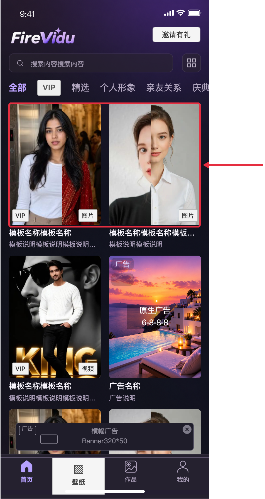
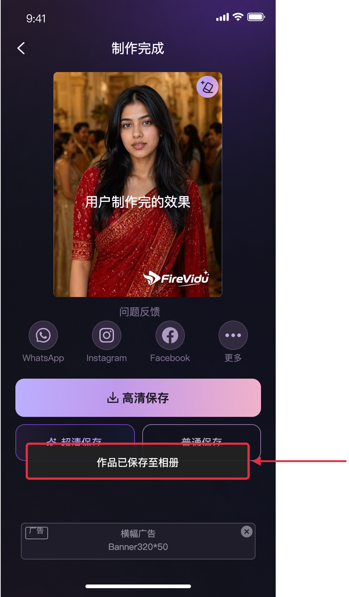
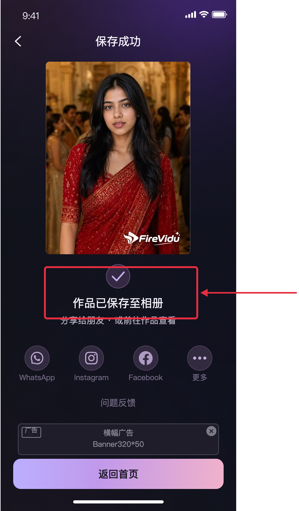

# FireVidu 首版模板埋点执行规范

FireVidu 首版模板埋点执行规范

版本 1.0    2026年11月20日

本规范供后续 AI 或开发实现模板风格统计使用。首版只采集封面曝光、封面点击、保存成功三个事件，回答哪些风格更吸引用户，以及点击后有多少用户最终保存作品。

本次交付仅为文档和附图，不修改现有原型、不接入真实采集。下文的实现步骤须在后续收到明确执行指令后开展。

## 一 本版范围

| 事件 | 记录位置 | 业务用途 |
|---|---|---|
| 封面曝光 | 首页 分类 精选 VIP 搜索结果中的模板封面 | 提供展示机会的分母 |
| 封面点击 | 用户点击模板封面进入详情 | 衡量风格吸引力 |
| 保存成功 | 图片成功提示或视频成功页对应的真实保存回报 | 衡量点击后的最终使用结果 |

所有列表复用同一套事件；图片和视频复用同一保存事件，通过输出形式区分。广告卡片、壁纸和已有作品的再次保存均不进入本模板转化漏斗。

### 后续实现的最小改动

复用现有模板与分类数据，保留稳定的模板和风格标识。现有字段能表达统计风格时直接复用；不能表达时先列出缺口，不让 AI 根据模板名称、封面人物或题材自动猜风格。未标注内容进入“未分类”。

首版无需新增上传、制作开始、广告、登录、反馈等事件。本规范不要求增加后台菜单、统计看板或新的 App 页面；统计表的接入位置由后续执行任务指定。

### 口径的性质

三个事件和缩小首版范围来自本轮需求。以下曝光门槛、24小时窗口和去重规则为本规范建议实现基线，尚未代表已上线行为或真实用户偏好。后续执行时统一采用，调整时同步修改本规范。

## 二 列表页面的曝光和点击

首页 各分类 精选 VIP 搜索结果均适用。下图是当前原型首页的代表截图，红框内每张模板卡片独立记录，不能把整个列表当作一次模板曝光。

**位置和原因**

模板封面同时承担曝光与点击采集。曝光让不同风格有可比较的分母；点击表示用户愿意进一步查看，不等同于满意。

**封面曝光**

事件 template_impression。封面至少50%可见且连续停留1秒，App在前台且卡片未被弹窗遮挡时记录。只生成一次当前曝光标识。

**封面点击**

事件 template_click。点击可用的模板封面时记录，带上当前曝光标识；进入详情由已有交互完成。原生广告卡片不记录模板点击。

**快速点击的补记**

用户在1秒内直接点击真实模板封面，先补一条有效曝光，再记点击，两者共用同一个曝光标识；已记录曝光时不重复补。

**原型说明位置**

将此处埋点解释写入列表现有右键说明，或合并到一个代表位置的说明中。无需每张封面增加红点、弹窗或新按钮。

## 三 图片和视频的保存成功

以下两种界面共用事件 template_save_success。红框是成功状态的展示位置，真正触发点是相册写入成功回报，不是页面展示、点保存按钮或广告看完。

| 图片 | 视频 |
|---|---|
| 原型在制作完成页显示“作品已保存至相册”提示。 | 原型进入“保存成功”页，并显示作品已保存至相册。 |
| 保留原成功提示和原流程，无需新增成功页。 | 保留原成功页面，无需为埋点增加额外确认。 |

同一保存操作的重复回报只生成一条成功事件；同一制作任务重复保存只计一次漏斗完成。普通、高清、超清都适用。失败、取消、权限拒绝、仅生成成功、仅预览均不计保存成功。

已有作品详情再次下载或保存不补记为一次新的模板使用。结果重新打开、成功提示重复显示，也不重新记成功。

## 四 三个事件的触发和去重

| 事件 | 必须满足的条件 | 禁止的实现 |
|---|---|---|
| template_impression | 50%可见连续1秒；同一浏览轮次同模板一次。快速点击允许先补曝光。 | 页面加载后把未滚动到的模板全部算曝光；广告算模板；重绘重复计数。 |
| template_click | 真实封面点击；携带对应曝光与本次流程标识。 | 用详情展示替代点击；把分类切换或广告点击算模板点击。 |
| template_save_success | 真实相册写入成功；关联原点击和任务；普通 高清 超清共用。 | 点保存即算成功；进入成功页即算成功；模拟回报冒充真实系统回报。 |

### 浏览轮次

首次进入某列表、主动刷新、切换分类、切换精选或VIP、提交新搜索各开启新轮次。从详情返回原列表并保留原位置时沿用旧轮次；同轮次滚出再滚入、重复渲染和横竖屏切换不重复曝光。同轮次超过24小时后按新轮次处理。

### 用户和事件去重

每条逻辑事件分配唯一 event_id，重发沿用同一值，接收端按此去重。曝光额外按 list_round_id 与 template_id 去重；保存按本次 creation_id 去重。封面再次点击可记录新点击事件和新 flow_id，用户人数指标仍去重。

游客使用稳定匿名用户标识，登录后关联到同一统计身份，不把登录前后当成两人。原型无法真实合并身份时，只展示关联约定，不能宣称已经完成跨设备去重。

### 时间和转化窗口

事件保存UTC时间，报表按印度标准时间 Asia/Kolkata 划分自然日。三个指标按同一曝光人群计算：点击关联该曝光，保存关联该点击；点击和保存均须发生在该曝光后24小时内，且保存晚于点击。超出窗口仍可保留原始事件，本次曝光的转化不增加。

选择时间段时，以曝光发生时间归组，后续符合窗口的点击和保存回归该组，不按保存发生日另计。最新24小时曝光的保存率尚未稳定，比较风格时优先选择观察期已结束的数据。

## 五 AI 必须保留的关联信息

以下是事件数据字段，不是新增给 App 用户填写的字段。编号只是关联用途，实际格式由开发确定。风格使用稳定ID，名称改动不能拆成两个风格。

| 字段 | 何时需要 | 含义 |
|---|---|---|
| event_id event_name occurred_at | 三个事件 | 唯一事件 标准事件名 UTC发生时间 |
| actor_id | 三个事件 | 合并游客和登录身份后的统计用户 |
| template_id style_id | 三个事件 | 模板与风格；style_id为空归未分类 |
| output_type vip source position | 三个事件 | image或video VIP属性 来源栏目 模板在列表内的位置 |
| list_round_id impression_id | 三个事件 | 对应浏览轮次与曝光；点击和保存继承原曝光 |
| flow_id click_event_id | 点击和保存 | 点击建立流程且click_event_id等于自身event_id；保存继承对应点击 |
| creation_id | 保存成功 | 本次任务或制作结果标识；重复保存去重 |

### 关联示例

模板甲属于电影感风格。用户甲看到模板甲时生成曝光甲；点封面时记录点击甲并建立流程甲；最终保存结果甲时带回曝光甲 点击甲 流程甲。三个事件因此能够归属于同一个模板、风格和用户。示例只解释关系，不代表真实数据。

点击后将来源与风格快照保存在该流程上下文，不能仅依赖“当前选中的模板”。切换到另一个模板时建立新流程；返回、登录、广告或用券不能丢失关联。风格标签在后台变更时，不追改已发生的事件。

### 实现与原型的边界

当前本地原型的保存是模拟流程。未来修改原型时可以演示记录三个事件及其关联，但必须标明模拟。正式 App 只在任务对应的真实保存组件确认写入相册后触发成功；本地提示、页面跳转和定时器不能作为正式成功凭据。

## 六 统计公式和结果表

先按选定时间段建立曝光集合，再通过 impression_id 和 click_event_id 查找同一24小时窗口内的点击和保存。按风格、输出形式和VIP条件分组后，再对用户去重。

| 指标 | 定义 |
|---|---|
| 曝光人数 E | 有效曝光用户的去重人数 |
| 点击人数 C | 关联曝光集合并在窗口内点击的去重人数 |
| 保存人数 S | 关联上述点击并在窗口内成功保存的去重人数 |

点击率 = C ÷ E × 100%

点击后保存率 = S ÷ C × 100%

曝光到保存率 = S ÷ E × 100%

分母为0时显示“—”，不是0%。正常数据应满足 S ≤ C ≤ E；不满足时排查关联或去重，不把超过100%的结果强行截断。不同风格的用户数不能直接相加作为全站用户数。

### 一张结果表即可

| 风格 | 曝光人数 | 点击人数 | 保存人数 | 点击率 | 点击后保存率 |
|---|---|---|---|---|---|
| 电影感 | 1000 | 100 | 40 | 10% | 40% |
| 卡通风 | 10000 | 300 | 30 | 3% | 10% |

上表是验算示例，不能用于判断印度市场偏好。只看点击人数会误判卡通风更好；结合展示机会和最终保存，电影感在此示例中更值得继续验证。曝光到保存率分别为4%与0.3%，可以计算但首版表格无需再加一列。

主看点击率和点击后保存率，同时保留人数。相同输出形式、VIP门槛及相近展示位置下比较多个模板；样本少先观察。高点击高保存的风格作为增产候选，不把保存直接宣称为满意或喜爱。

## 七 后续执行指令和验收

本次仅交付文档，不执行下列修改。后续收到“按文档实现”指令的 AI，应先阅读项目协作要求和实际实现，再按下列顺序完成。

1 核对已有模板ID 风格字段 用户标识和保存成功回报。复用已有事件；缺少风格标签或真实保存回报时，报告具体缺口，不猜测或伪造。

2 只实现三个事件及最少关联信息，复用所有模板列表和图片视频保存流程，不增加中间漏斗事件。

3 原型如需体现埋点，只合并右键说明；保持现有页面布局和业务路径，不为埋点增加用户表单或逐卡红点。截图中的红框箭头用于文档说明。

4 正式采集与本地模拟分开；测试数据不进正式报表。接收接口或真实SDK缺失时，不伪造接入成功。采集失败不阻断业务。

5 用下表验收并记录证据。根据后续任务要求更新文档、版本记录与Git，不覆盖无关的既有修改。

| 测试场景 | 预期结果 |
|---|---|
| 封面可见不足50% 或停留不足1秒未点 | 无有效曝光 |
| 可见达到门槛 重绘 滚出再滚入 | 本轮该模板只记1次曝光 |
| 0.5秒内点击模板封面 | 先补1条曝光 再记1条点击 两者关联 |
| 广告卡片或壁纸被点击 | 本模板漏斗无新增事件 |
| 图片和视频分别保存成功 | 各走同一个成功事件 关联各自点击 |
| 保存失败 取消 权限拒绝或只看广告 | 保存人数不增加 |
| 同任务重复成功回报或重复保存 | 一次漏斗完成 重发不重复入库 |
| 登录前点击 登录后保存 | 按同一统计用户和同一流程关联 |
| 旧作品再次保存 或超过24小时窗口 | 不补记本次曝光集合的转化 |
| 1000曝光 100点击 40保存的样本 | 10%点击率 40%点击后保存率 4%曝光到保存率 |
